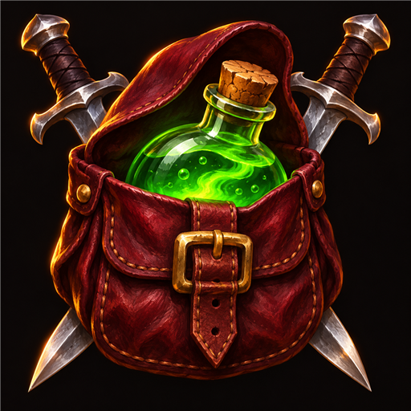

# Poison Satchel

Poison Satchel helps rogues in **World of Warcraft Forever** restock and apply poisons. At a poison vendor, choose a recipe and how many times to craft it. The manager compares the ingredients with what's in your bags and shows how much the missing supplies will cost.

## Getting started

1. Copy the [PoisonSatchel](PoisonSatchel/) folder into `_forever_/Interface/AddOns/`. The file `PoisonSatchel_Forever.toc` should sit directly inside `AddOns/PoisonSatchel/`.
2. Enable **Poison Satchel** in the character selection AddOns list. Open your **Poisons** profession once in game so the manager can read your learned recipes.
3. Visit a poison supplier, choose a poison and enter a craft quantity. Buy the missing ingredients, then click **Prepare craft**. Confirm with **Create** in the Poisons window.

The manager shows the highest learned rank of each poison by default. Enable **Show all learned ranks** to prepare a lower rank.

## Apply poison from the character sheet

Outside combat, right-click an equipped main-hand or off-hand weapon to see the poisons and ranks in your bags. Click a poison to apply it to that weapon. If WoW asks whether to replace an existing coating, confirm in the game prompt.

## Poison action bar

The bar has one slot each for Instant, Deadly, Wound, Crippling, and Mind-numbing Poison. A colored icon shows the highest rank in your bags and how many you have of that rank. A gray icon means you have none of that poison. Left-click or right-click a stocked poison, then select the weapon to coat.

Click the **Poisons crafting icon** at the end of the bar to open the profession. Right-drag that icon to move the bar. Its position is saved per character.

During the last minute of a poison coating, an amber countdown under the bar shows which hand needs attention. When the coating runs out, a muted **Poison expired** label stays until you reapply or swap weapons. Each coating also gets one private chat reminder during its last minute, even with the bar hidden.

## Minimap and settings

| Control | Action |
| --- | --- |
| Left-click the minimap icon | Open the poison manager. |
| Right-click the minimap icon | Open the manager, toggle the poison bar or expiration reminders, or jump to addon settings. |
| Drag the minimap icon | Move it around the minimap. |
| Type `/poisonsatchel` or `/venom` | Open the poison manager. |

Preferences are under **Settings → AddOns → Poison Satchel**. **Poison expiration reminders** controls both the countdown and private chat messages. It is enabled by default and saved per character. Action bar visibility changes take effect after combat if you toggle the bar during a fight.

## Publishing a release

Set the version in `PoisonSatchel/PoisonSatchel_Forever.toc` and push the release commit to `main`. Create a branch from that commit named `release/vX.Y.Z`, such as `release/v0.3.10`. GitHub Actions checks the version against the TOC, builds the ZIP, creates the matching tag, and publishes the release. Pushing a matching tag directly also triggers the workflow.

For CurseForge, upload the attached `PoisonSatchel-vX.Y.Z.zip` from the release. To build the same file locally, run `./scripts/Build-Addon.ps1` in PowerShell 7. The ZIP is written to `dist/`.

## License

[MIT](LICENSE)
